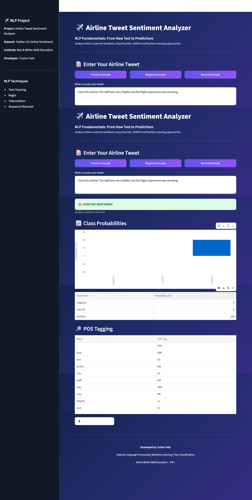

<div align="center">


# ✈️ Airline Tweet Sentiment Analyzer

### NLP Fundamentals — From Raw Text to Predictions

**An interactive NLP application for analysing airline customer feedback and predicting sentiment.**


</div>

---

## 📌 About the Project

The **Airline Tweet Sentiment Analyzer** is a Natural Language Processing project developed to analyse customer feedback about airline services.

The application accepts text input from users and identifies the sentiment as:

- 😊 Positive Sentiment
- 😠 Negative Sentiment
- 😐 Neutral Sentiment

It demonstrates how NLP techniques and machine learning can transform raw text into useful insights.

### Project Information

| Detail | Description |
|---|---|
| Project Name | Airline Tweet Sentiment Analyzer |
| Domain | Natural Language Processing |
| Dataset | Twitter US Airline Sentiment |
| Institute | Red & White Skill Education |
| Developer | Tushar Vala |
| Interface | Streamlit |

---

## 🖥️ Project Dashboard

Here is a preview of my interactive Streamlit application.

<p align="center">
  
</p>

---

## ✨ Key Features

### 1. Interactive Tweet Analysis
- Enter your own airline-related tweet.
- Use predefined positive, negative and neutral examples.
- Analyse customer feedback instantly.

### 2. NLP Text Processing
- Text cleaning
- Regular expressions
- Tokenization
- Stop-word handling
- Text normalization

### 3. Sentiment Analysis
- Heuristic Sentiment Analysis
- VADER Sentiment Analysis
- Machine Learning Classification

### 4. Analysis Results
- Cleaned text display
- Predicted sentiment
- Class probability visualization
- Sentiment probability table
- POS tagging

### 5. Report Generation
- Download the analysed tweet report.
- Export analysis results in CSV format.

---

## 🧠 NLP Techniques Used

| NLP Technique | Description |
|---|---|
| RegEx | Text pattern matching and cleaning |
| Tokenization | Splitting text into tokens |
| Stop Words | Handling common words |
| Bag of Words | Text representation using word counts |
| TF-IDF | Measuring word importance |
| N-Grams | Capturing word combinations |
| VADER | Lexicon-based sentiment analysis |
| Word2Vec | Word embedding representation |
| POS Tagging | Identifying grammatical word categories |
| Classification | Predicting sentiment labels |

---

## 🛠️ Technologies Used

<p>

</p>

- Python
- Streamlit
- Pandas
- NumPy
- NLTK
- Scikit-learn
- Gensim
- Matplotlib
- Seaborn
- Joblib

---

## 📂 Project Structure

```text
NLP_PR1/
│
├── app.py
├── nlp_utils.py
├── NLP_PR1.ipynb
├── sentiment_model.joblib
├── requirements.txt
├── README.md
├── LICENSE
├── .gitignore
│
├── assets/
│   └── nlp-dashboard.png
│
└── .streamlit/
    └── config.toml
```

**File descriptions:**

| File | Purpose |
|---|---|
| `app.py` | Main Streamlit application |
| `nlp_utils.py` | NLP helper functions |
| `NLP_PR1.ipynb` | Complete practical notebook |
| `sentiment_model.joblib` | Trained ML pipeline |
| `requirements.txt` | Required Python packages |
| `README.md` | Project documentation |
| `LICENSE` | Project license |
| `.gitignore` | Files excluded from GitHub |
| `assets/` | Project screenshots |
| `.streamlit/` | Streamlit configuration |

---

## ⚙️ Installation Guide

### Step 1: Clone Repository

```bash
git clone https://github.com/tushar123851/NLP-PR1.git
```

```bash
cd NLP-PR1
```

### Step 2: Create Virtual Environment

```bash
python -m venv .venv
```

Activate it using PowerShell:

```powershell
.\.venv\Scripts\Activate.ps1
```

### Step 3: Install Dependencies

```bash
pip install -r requirements.txt
```

### Step 4: Download Dataset

Download the Twitter US Airline Sentiment dataset:

https://www.kaggle.com/datasets/crowdflower/twitter-airline-sentiment

Place `Tweets.csv` inside the main project folder.

### Step 5: Run Jupyter Notebook

```bash
jupyter notebook NLP_PR1.ipynb
```

Execute the notebook cells in order.

### Step 6: Run Streamlit Application

```bash
streamlit run app.py
```

Open the local URL displayed in your terminal.

---

## 🚀 How to Use

1. Open the Airline Tweet Sentiment Analyzer.
2. Enter an airline-related customer tweet.
3. Select an analysis approach.
4. Click **Analyse Sentiment**.
5. View the cleaned text.
6. Check the predicted sentiment.
7. Explore class probabilities.
8. Review POS tagging results.
9. Download your analysis report.

---

## 🧪 Sample Tweets

| Sentiment | Example |
|---|---|
| Positive | The cabin crew was friendly and the flight was amazing! |
| Negative | My flight was delayed and customer service was terrible. |
| Neutral | My flight is scheduled for tomorrow at 8 PM. |

These are demonstration examples, not actual dataset records.

---

## 📊 Model Evaluation

The notebook includes experiments for model evaluation, including:

- Accuracy
- Precision
- Recall
- F1-score
- Confusion Matrix
- Five-fold Cross Validation

**Important:** Actual model scores should be added here after running the notebook with the real dataset. No evaluation results are assumed.

---

## ☁️ Deployment

This Streamlit project can be deployed using:

https://share.streamlit.io/

Deployment requirements:

- GitHub repository
- `app.py`
- `nlp_utils.py`
- `requirements.txt`
- Trained model file if using Machine Learning
- All required dependencies

---

## 🔮 Future Enhancements

- Airline-wise sentiment comparison.
- Interactive sentiment analytics dashboard.
- Customer feedback trend analysis.
- Improved handling of emojis and negation.
- PDF report generation.
- Model performance comparison.

---

## 👨‍💻 About Developer

<div align="center">

# Tushar Vala

### Aspiring Data Analyst | AI/ML Developer

</div>

---

<div align="center">

### ⭐ Thank You for Visiting My Project!

**Built with Python | Natural Language Processing | Machine Learning | Streamlit**

Red & White Skill Education — NLP Fundamentals PR 1

</div>
